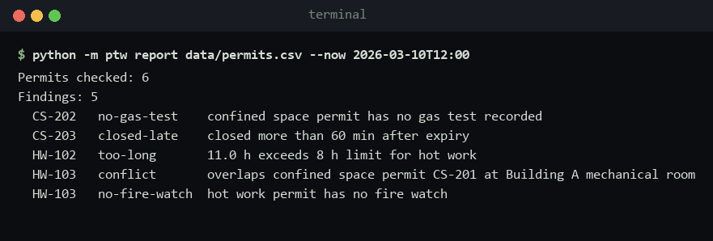

# permit-to-work-tracker

Reads a permit log in CSV and lists every hot work or confined space permit that breaks a basic rule.



## What it is for

Hot work and confined space permits are often tracked on paper or in a spreadsheet, and nobody notices a permit that ran past its window, was never closed, or overlaps another permit in the same room. A safety officer, facility coordinator or contractor supervisor exports the permit log and runs this tool. They get a short list of permits to chase, each with the rule it broke.

## Install

```
git clone <repo-url> permit-to-work-tracker
cd permit-to-work-tracker
pip install -e .
```

Python 3.10 or newer. No dependencies.

## How to use

| I want to | Command |
|---|---|
| Check the log as of the current time | `python -m ptw report data/permits.csv` |
| Check the log as of a given time | `python -m ptw report data/permits.csv --now 2026-03-10T12:00` |
| See the help for the report command | `python -m ptw report --help` |
| Run the tests | `python -m pytest -q` |

The exit code is 0 when clean, 1 when there are findings, 2 on bad input.

Worked example:

```
python -m ptw report data/permits.csv --now 2026-03-10T12:00
```

```
Permits checked: 6
Findings: 5
  CS-202   no-gas-test    confined space permit has no gas test recorded
  CS-203   closed-late    closed more than 60 min after expiry
  HW-102   too-long       11.0 h exceeds 8 h limit for hot work
  HW-103   conflict       overlaps confined space permit CS-201 at Building A mechanical room
  HW-103   no-fire-watch  hot work permit has no fire watch
```

## How it works

- Each row is one permit with kind, location, issue time, expiry, close time, gas test and fire watch flags.
- Hot work may run at most 8 hours, confined space at most 12 hours.
- Confined space permits need a recorded gas test. Hot work permits need a fire watch.
- A permit with no close time that is past its expiry is reported as not closed.
- A permit closed more than 60 minutes after expiry is reported as closed late.
- A hot work and a confined space permit whose time windows overlap in the same location are reported as a conflict.

## Limits

The limits (8 and 12 hours, 60 minute grace) are constants in `src/ptw/core.py`, not read from your site rules. It is a log checker, not a permit approval system, and it does not replace your safety procedure.

## License

MIT. Copyright 2026 Yassine Emhamed.
